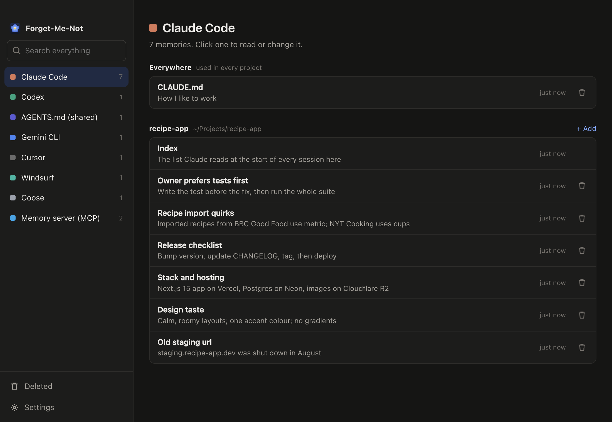
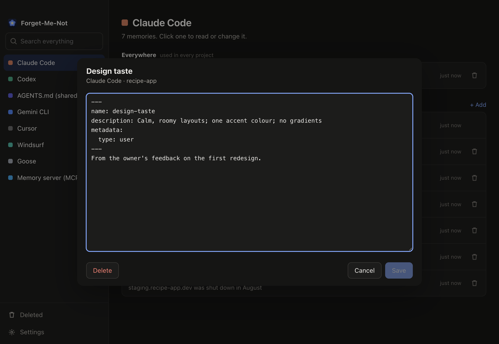

<p align="center">
  
</p>

<h1 align="center">Forget-Me-Not</h1>

<p align="center"><b>See, change and delete what your AI tools remember — all in one place.</b><br>
Claude Code, Codex, Cursor, Gemini CLI, Windsurf, GitHub Copilot and 30 more. Mac, Windows, Linux — and your phone.</p>

<p align="center"></p>

AI tools quietly collect notes about you and your projects. Over time they pile up — outdated, wrong, or things you'd
rather they didn't keep. Each tool hides them somewhere different. Forget-Me-Not finds them all and lets you tidy up.

## Download

Get the installer for your computer from **[Releases](https://github.com/sh1lll/forget-me-not/releases)**:

| | |
|---|---|
| **Mac** | `Forget-Me-Not-…-mac-arm64.dmg` (Apple silicon) or `…-mac-x64.dmg` (Intel) |
| **Windows** | `Forget-Me-Not-…-win-x64.exe` |
| **Linux** | `Forget-Me-Not-…-linux-x86_64.AppImage` or `.deb` |

> **First launch:** the app isn't signed with a paid developer certificate yet, so your computer will be cautious.
> **Mac:** right-click the app → **Open** → **Open**. **Windows:** click **More info** → **Run anyway**.

Prefer no installer? With [Node.js](https://nodejs.org) installed: `git clone` this repo, then `npm install` and
`npm start` — it opens in your browser.

## Using it

- **Pick an app** on the left. You'll see everything it remembers.
- **Click a memory** to read or change it.
- **Click 🗑 to delete.** Changed your mind? Press **Undo** — or find it later in **Deleted**.
- **Search** looks through every app at once.

<p align="center"></p>

## What it works with

| | |
|---|---|
| **AI coding tools** | Claude Code · Codex · Gemini CLI · Cursor · Windsurf · GitHub Copilot · Cline · Roo Code · Kilo Code · Continue · Goose · Amp · opencode · Factory · Kiro · Qwen Code · Crush · JetBrains Junie · JetBrains AI Assistant · Augment · Trae · Amazon Q · Firebase Studio · OpenHands · Sourcegraph Cody · Tabnine · Void · Codebuff · Aider · Zed · Hermes · any project's `AGENTS.md` |
| **Apps with a memory database** | Open WebUI · Codex learned memories |
| **Memory plugins** | MCP memory server (used by Claude Desktop, Cursor and others) |
| **Online memory services** | Mem0 · Letta — add your API key in Settings |
| **Anything else** | Settings → *Add another memory source* |

Apps appear by themselves once they're on your computer.

**Not possible:** ChatGPT, Claude.ai and Gemini keep their memory on their own servers and don't let other apps reach
it. Edit those inside the apps themselves.

## Settings

- **Sync across your computers** — pick a folder that iCloud, Dropbox, OneDrive or Google Drive already syncs, on each
  computer. Edits and deletions follow you; if the same memory changed on two computers, the newer one wins and the
  other goes to Deleted.
- **Use on your phone** — turn it on and open the link it shows on your phone (same Wi-Fi). The link works like a
  password, so keep it to yourself.

## Safe by design

- **Nothing leaves your computer.** It runs only on your machine. The only exceptions are ones you turn on: your sync
  folder, your phone, or an online service you connect.
- **Nothing is lost.** Deleted memories and earlier versions of anything you change are kept in **Deleted** until you
  remove them (they live in `~/.forget-me-not/deleted`).
- **It won't overwrite an app mid-write.** If an AI tool changes a memory while you're editing it, saving stops and
  asks you to reopen it.
- **Your API keys stay private** — stored only on your computer, readable only by you, never shown to your phone.

## Uninstall

Delete the app (Mac: drag it to the Trash · Windows: *Settings → Apps* · Linux: delete the AppImage). Your memories are
untouched — they belong to your AI tools, not to Forget-Me-Not. To also remove its own settings and Deleted items,
delete the `~/.forget-me-not` folder.

## For developers

```
npm install
npm run app      # desktop app
npm start        # browser version
npm test         # tests
npm run dist     # build installers for this system
```

Adding another AI tool is usually one line in [`lib/sources.mjs`](lib/sources.mjs): where it keeps its memory, globally
and inside projects. See [CONTRIBUTING.md](CONTRIBUTING.md) — pull requests welcome.

## License

[Apache License 2.0](LICENSE) © sh1lll
